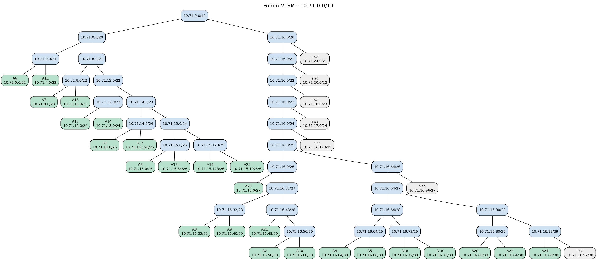
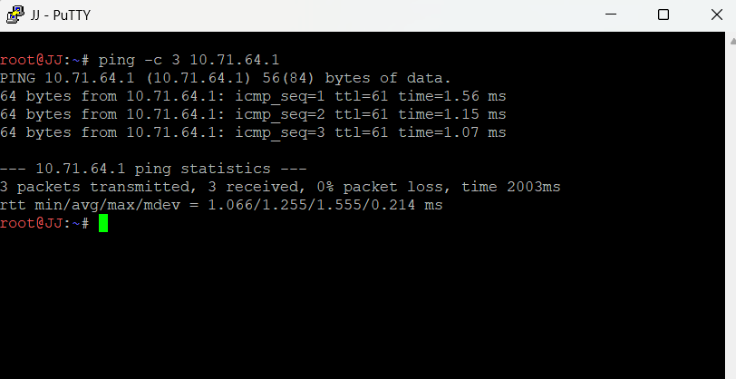
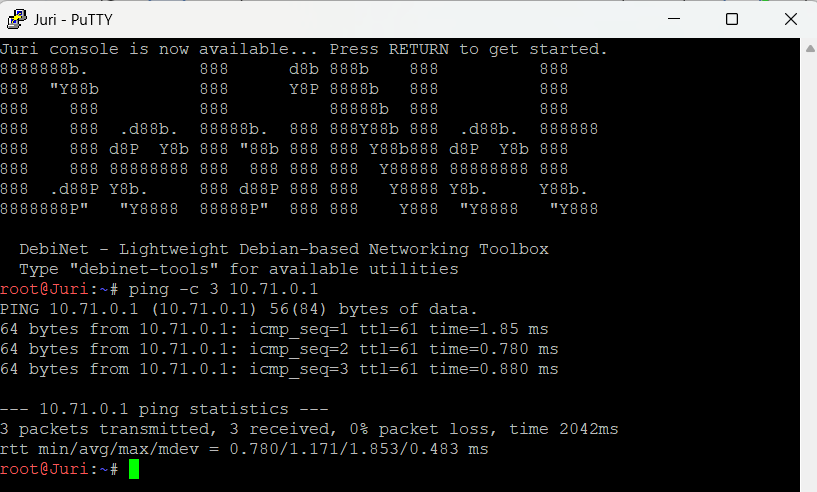

# Jarkom-Modul-4-2026-K-15

| Nama | NRP |
| ---  | --- |
| I Made Tobby Anantha Adiwijaya | 5027251064 |
| Rheza Pramudita Adi Putra | 5027251090 |

## Link Spreadsheet
[LINK SPREADSHEET]  
https://docs.google.com/spreadsheets/d/11alOrE_nM6N1S3ChYQFPtsKm0776pas7/edit?usp=sharing

## CPT - VLSM

VLSM (Variable Length Subnet Mask) membagi satu blok alamat menjadi subnet dengan netmask berbeda sesuai kebutuhan tiap jaringan. Subnet besar mendapat blok besar, dan link antar router cukup /30, sehingga alamat tidak terbuang.

### Aturan hitung
1. **Jumlah IP** = jumlah host + jumlah interface router pada subnet itu.
2. **Netmask** = netmask terkecil yang alamat usable-nya (2^n - 2) cukup untuk Jumlah IP.
3. **Urutkan** subnet dari yang terbesar, lalu alokasikan berurutan dari `10.71.0.0` tanpa celah.

### Kenapa induknya /19
Jumlah IP semua subnet adalah 2814, yang terlihat muat di /20 (4096 alamat). Tapi tiap subnet memakai blok utuh, dan total bloknya 4188 alamat. Angka itu lebih dari 4096, jadi induknya **10.71.0.0/19** (8192 alamat).

### Tabel rute
| Subnet | Rute | Perhitungan | Jumlah IP | Netmask |
|---|---|---|---|---|
| A1 | Cyberia > Switch1 > JJ, MyuMyu | 95 + 30 + 1 | 126 | /25 |
| A2 | Cyberia > Wired | 2 router | 2 | /30 |
| A3 | Wired > Switch2 > Psyche, Copland, Schumann | 4 router | 4 | /29 |
| A4 | Wired > Navi | 2 router | 2 | /30 |
| A5 | Wired > Tachibana | 2 router | 2 | /30 |
| A6 | Psyche > Switch3 > Karl, Lin | 700 + 180 + 1 | 881 | /22 |
| A7 | Copland > Switch4 > Masayuki | 300 + 1 | 301 | /23 |
| A8 | Copland > Juri | 31 + 1 | 32 | /26 |
| A9 | Schumann > Akashic | 3 + 1 | 4 | /29 |
| A10 | Schumann > Accela | 2 router | 2 | /30 |
| A11 | Accela > Switch5 > Omnipresence, Denpa | 510 + 3 + 1 | 514 | /22 |
| A12 | Navi > Switch6 > Alice, Reika | 208 + 45 + 1 | 254 | /24 |
| A13 | Navi > Switch7 > Taro | 57 + 1 | 58 | /26 |
| A14 | Navi > Switch8 > Yasuo, Miho, Kuma | 120 + 18 + 4 + 1 | 143 | /24 |
| A15 | Tachibana > Switch9 > Collective, Ghost | 260 + 6 + 1 | 267 | /23 |
| A16 | Tachibana > Deus | 2 router | 2 | /30 |
| A17 | Deus > Switch10 > Lilith, Specter | 77 + 21 + 1 | 99 | /25 |
| A18 | Deus > Protocol7 | 2 router | 2 | /30 |
| A19 | Protocol7 > Switch11 > Chisa, Hodgeson | 23 + 9 + 1 | 33 | /26 |
| A20 | Protocol7 > Knights | 2 router | 2 | /30 |
| A21 | Knights > Eiri | 2 + 1 | 3 | /29 |
| A22 | Knights > Phantoma | 2 router | 2 | /30 |
| A23 | Phantoma > Switch12 > Semi | 14 + 1 | 15 | /27 |
| A24 | Phantoma > Shibuya | 2 router | 2 | /30 |
| A25 | Shibuya > Switch13 > Lain, Mika | 57 + 4 + 1 | 62 | /26 |
| Total | | | 2814 | /19 |

### Pembagian IP
Urutan tabel ini mengikuti urutan alokasi, dari blok terbesar.

| Subnet | Network ID | Netmask | Broadcast | Range IP |
|---|---|---|---|---|
| A6 | 10.71.0.0 | 255.255.252.0 | 10.71.3.255 | 10.71.0.1 - 10.71.3.254 |
| A11 | 10.71.4.0 | 255.255.252.0 | 10.71.7.255 | 10.71.4.1 - 10.71.7.254 |
| A7 | 10.71.8.0 | 255.255.254.0 | 10.71.9.255 | 10.71.8.1 - 10.71.9.254 |
| A15 | 10.71.10.0 | 255.255.254.0 | 10.71.11.255 | 10.71.10.1 - 10.71.11.254 |
| A12 | 10.71.12.0 | 255.255.255.0 | 10.71.12.255 | 10.71.12.1 - 10.71.12.254 |
| A14 | 10.71.13.0 | 255.255.255.0 | 10.71.13.255 | 10.71.13.1 - 10.71.13.254 |
| A1 | 10.71.14.0 | 255.255.255.128 | 10.71.14.127 | 10.71.14.1 - 10.71.14.126 |
| A17 | 10.71.14.128 | 255.255.255.128 | 10.71.14.255 | 10.71.14.129 - 10.71.14.254 |
| A8 | 10.71.15.0 | 255.255.255.192 | 10.71.15.63 | 10.71.15.1 - 10.71.15.62 |
| A13 | 10.71.15.64 | 255.255.255.192 | 10.71.15.127 | 10.71.15.65 - 10.71.15.126 |
| A19 | 10.71.15.128 | 255.255.255.192 | 10.71.15.191 | 10.71.15.129 - 10.71.15.190 |
| A25 | 10.71.15.192 | 255.255.255.192 | 10.71.15.255 | 10.71.15.193 - 10.71.15.254 |
| A23 | 10.71.16.0 | 255.255.255.224 | 10.71.16.31 | 10.71.16.1 - 10.71.16.30 |
| A3 | 10.71.16.32 | 255.255.255.248 | 10.71.16.39 | 10.71.16.33 - 10.71.16.38 |
| A9 | 10.71.16.40 | 255.255.255.248 | 10.71.16.47 | 10.71.16.41 - 10.71.16.46 |
| A21 | 10.71.16.48 | 255.255.255.248 | 10.71.16.55 | 10.71.16.49 - 10.71.16.54 |
| A2 | 10.71.16.56 | 255.255.255.252 | 10.71.16.59 | 10.71.16.57 - 10.71.16.58 |
| A10 | 10.71.16.60 | 255.255.255.252 | 10.71.16.63 | 10.71.16.61 - 10.71.16.62 |
| A4 | 10.71.16.64 | 255.255.255.252 | 10.71.16.67 | 10.71.16.65 - 10.71.16.66 |
| A5 | 10.71.16.68 | 255.255.255.252 | 10.71.16.71 | 10.71.16.69 - 10.71.16.70 |
| A16 | 10.71.16.72 | 255.255.255.252 | 10.71.16.75 | 10.71.16.73 - 10.71.16.74 |
| A18 | 10.71.16.76 | 255.255.255.252 | 10.71.16.79 | 10.71.16.77 - 10.71.16.78 |
| A20 | 10.71.16.80 | 255.255.255.252 | 10.71.16.83 | 10.71.16.81 - 10.71.16.82 |
| A22 | 10.71.16.84 | 255.255.255.252 | 10.71.16.87 | 10.71.16.85 - 10.71.16.86 |
| A24 | 10.71.16.88 | 255.255.255.252 | 10.71.16.91 | 10.71.16.89 - 10.71.16.90 |

### Konsep routing
Topologi ini berbentuk pohon dengan Cyberia di puncak, jadi routing-nya memakai static route dengan dua aturan:
- **Ke arah atas:** setiap router punya satu default route ke router di atasnya.
- **Ke arah bawah:** router hanya mencatat subnet di bawahnya yang tidak terhubung langsung, dengan next hop router anak.

Supaya efisien, subnet berdampingan dengan next hop sama digabung. Contohnya `10.71.12.0/23` di Wired mencakup A12 dan A14, karena keduanya lewat Navi. Router ujung seperti Psyche, Copland, Accela, Navi, dan Shibuya cukup punya default route.

### Langkah 1: konfigurasi router
Klik router, buka tab **CLI**, lalu ketik perintahnya. Jawab `no` kalau muncul dialog konfigurasi awal.

**Cyberia**
```
enable
configure terminal
hostname Cyberia
interface FastEthernet0/0
no shutdown
exit
interface FastEthernet0/1
ip address 10.71.14.1 255.255.255.128
no shutdown
exit
interface FastEthernet1/0
ip address 10.71.16.57 255.255.255.252
no shutdown
exit
ip route 0.0.0.0 0.0.0.0 FastEthernet0/0
ip route 10.71.0.0 255.255.224.0 10.71.16.58
end
write memory
```

**Wired**
```
enable
configure terminal
hostname Wired
interface FastEthernet1/0
ip address 10.71.16.58 255.255.255.252
no shutdown
exit
interface FastEthernet0/0
ip address 10.71.16.33 255.255.255.248
no shutdown
exit
interface FastEthernet1/1
ip address 10.71.16.65 255.255.255.252
no shutdown
exit
interface FastEthernet0/1
ip address 10.71.16.69 255.255.255.252
no shutdown
exit
ip route 0.0.0.0 0.0.0.0 10.71.16.57
ip route 10.71.0.0 255.255.252.0 10.71.16.34
ip route 10.71.8.0 255.255.254.0 10.71.16.35
ip route 10.71.15.0 255.255.255.192 10.71.16.35
ip route 10.71.4.0 255.255.252.0 10.71.16.36
ip route 10.71.16.40 255.255.255.248 10.71.16.36
ip route 10.71.16.60 255.255.255.252 10.71.16.36
ip route 10.71.12.0 255.255.254.0 10.71.16.66
ip route 10.71.15.64 255.255.255.192 10.71.16.66
ip route 10.71.10.0 255.255.254.0 10.71.16.70
ip route 10.71.14.128 255.255.255.128 10.71.16.70
ip route 10.71.15.128 255.255.255.128 10.71.16.70
ip route 10.71.16.0 255.255.255.224 10.71.16.70
ip route 10.71.16.48 255.255.255.248 10.71.16.70
ip route 10.71.16.72 255.255.255.248 10.71.16.70
ip route 10.71.16.80 255.255.255.240 10.71.16.70
end
write memory
```

**Psyche**
```
enable
configure terminal
hostname Psyche
interface FastEthernet0/0
ip address 10.71.16.34 255.255.255.248
no shutdown
exit
interface FastEthernet0/1
ip address 10.71.0.1 255.255.252.0
no shutdown
exit
ip route 0.0.0.0 0.0.0.0 10.71.16.33
end
write memory
```

**Copland**
```
enable
configure terminal
hostname Copland
interface FastEthernet0/0
ip address 10.71.16.35 255.255.255.248
no shutdown
exit
interface FastEthernet0/1
ip address 10.71.8.1 255.255.254.0
no shutdown
exit
interface FastEthernet1/0
ip address 10.71.15.1 255.255.255.192
no shutdown
exit
ip route 0.0.0.0 0.0.0.0 10.71.16.33
end
write memory
```

**Schumann**
```
enable
configure terminal
hostname Schumann
interface FastEthernet0/0
ip address 10.71.16.36 255.255.255.248
no shutdown
exit
interface FastEthernet0/1
ip address 10.71.16.41 255.255.255.248
no shutdown
exit
interface FastEthernet1/0
ip address 10.71.16.61 255.255.255.252
no shutdown
exit
ip route 0.0.0.0 0.0.0.0 10.71.16.33
ip route 10.71.4.0 255.255.252.0 10.71.16.62
end
write memory
```

**Accela**
```
enable
configure terminal
hostname Accela
interface FastEthernet0/1
ip address 10.71.16.62 255.255.255.252
no shutdown
exit
interface FastEthernet0/0
ip address 10.71.4.1 255.255.252.0
no shutdown
exit
ip route 0.0.0.0 0.0.0.0 10.71.16.61
end
write memory
```

**Navi**
```
enable
configure terminal
hostname Navi
interface FastEthernet1/1
ip address 10.71.16.66 255.255.255.252
no shutdown
exit
interface FastEthernet0/0
ip address 10.71.12.1 255.255.255.0
no shutdown
exit
interface FastEthernet0/1
ip address 10.71.15.65 255.255.255.192
no shutdown
exit
interface FastEthernet1/0
ip address 10.71.13.1 255.255.255.0
no shutdown
exit
ip route 0.0.0.0 0.0.0.0 10.71.16.65
end
write memory
```

**Tachibana**
```
enable
configure terminal
hostname Tachibana
interface FastEthernet0/1
ip address 10.71.16.70 255.255.255.252
no shutdown
exit
interface FastEthernet0/0
ip address 10.71.10.1 255.255.254.0
no shutdown
exit
interface FastEthernet1/0
ip address 10.71.16.73 255.255.255.252
no shutdown
exit
ip route 0.0.0.0 0.0.0.0 10.71.16.69
ip route 10.71.14.128 255.255.255.128 10.71.16.74
ip route 10.71.15.128 255.255.255.128 10.71.16.74
ip route 10.71.16.0 255.255.255.224 10.71.16.74
ip route 10.71.16.48 255.255.255.248 10.71.16.74
ip route 10.71.16.76 255.255.255.252 10.71.16.74
ip route 10.71.16.80 255.255.255.240 10.71.16.74
end
write memory
```

**Deus**
```
enable
configure terminal
hostname Deus
interface FastEthernet0/1
ip address 10.71.16.74 255.255.255.252
no shutdown
exit
interface FastEthernet0/0
ip address 10.71.14.129 255.255.255.128
no shutdown
exit
interface FastEthernet1/0
ip address 10.71.16.77 255.255.255.252
no shutdown
exit
ip route 0.0.0.0 0.0.0.0 10.71.16.73
ip route 10.71.15.128 255.255.255.128 10.71.16.78
ip route 10.71.16.0 255.255.255.224 10.71.16.78
ip route 10.71.16.48 255.255.255.248 10.71.16.78
ip route 10.71.16.80 255.255.255.240 10.71.16.78
end
write memory
```

**Protocol7**
```
enable
configure terminal
hostname Protocol7
interface FastEthernet0/1
ip address 10.71.16.78 255.255.255.252
no shutdown
exit
interface FastEthernet0/0
ip address 10.71.15.129 255.255.255.192
no shutdown
exit
interface FastEthernet1/0
ip address 10.71.16.81 255.255.255.252
no shutdown
exit
ip route 0.0.0.0 0.0.0.0 10.71.16.77
ip route 10.71.15.192 255.255.255.192 10.71.16.82
ip route 10.71.16.0 255.255.255.224 10.71.16.82
ip route 10.71.16.48 255.255.255.248 10.71.16.82
ip route 10.71.16.80 255.255.255.240 10.71.16.82
end
write memory
```

**Knights**
```
enable
configure terminal
hostname Knights
interface FastEthernet0/1
ip address 10.71.16.82 255.255.255.252
no shutdown
exit
interface FastEthernet0/0
ip address 10.71.16.49 255.255.255.248
no shutdown
exit
interface FastEthernet1/0
ip address 10.71.16.85 255.255.255.252
no shutdown
exit
ip route 0.0.0.0 0.0.0.0 10.71.16.81
ip route 10.71.15.192 255.255.255.192 10.71.16.86
ip route 10.71.16.0 255.255.255.224 10.71.16.86
ip route 10.71.16.88 255.255.255.252 10.71.16.86
end
write memory
```

**Phantoma**
```
enable
configure terminal
hostname Phantoma
interface FastEthernet0/1
ip address 10.71.16.86 255.255.255.252
no shutdown
exit
interface FastEthernet0/0
ip address 10.71.16.1 255.255.255.224
no shutdown
exit
interface FastEthernet1/0
ip address 10.71.16.89 255.255.255.252
no shutdown
exit
ip route 0.0.0.0 0.0.0.0 10.71.16.85
ip route 10.71.15.192 255.255.255.192 10.71.16.90
end
write memory
```

**Shibuya**
```
enable
configure terminal
hostname Shibuya
interface FastEthernet0/1
ip address 10.71.16.90 255.255.255.252
no shutdown
exit
interface FastEthernet0/0
ip address 10.71.15.193 255.255.255.192
no shutdown
exit
ip route 0.0.0.0 0.0.0.0 10.71.16.89
end
write memory
```

`FastEthernet0/0` di Cyberia terhubung ke Cloud dan tidak diberi IP, jadi default route Cyberia tertulis di konfigurasi tapi tidak aktif. Ping antar node tidak terpengaruh, karena semua subnet tercakup `10.71.0.0/19`.

### Langkah 2: konfigurasi host
Klik host, pilih **Desktop > IP Configuration**, pilih **Static**, lalu isi sesuai tabel.

| Node | Subnet | IP | Netmask | Gateway |
|---|---|---|---|---|
| JJ | A1 | 10.71.14.2 | 255.255.255.128 | 10.71.14.1 |
| MyuMyu | A1 | 10.71.14.3 | 255.255.255.128 | 10.71.14.1 |
| Karl | A6 | 10.71.0.2 | 255.255.252.0 | 10.71.0.1 |
| Lin | A6 | 10.71.0.3 | 255.255.252.0 | 10.71.0.1 |
| Juri | A8 | 10.71.15.2 | 255.255.255.192 | 10.71.15.1 |
| Masayuki | A7 | 10.71.8.2 | 255.255.254.0 | 10.71.8.1 |
| Akashic | A9 | 10.71.16.42 | 255.255.255.248 | 10.71.16.41 |
| Omnipresence | A11 | 10.71.4.2 | 255.255.252.0 | 10.71.4.1 |
| Denpa | A11 | 10.71.4.3 | 255.255.252.0 | 10.71.4.1 |
| Alice | A12 | 10.71.12.2 | 255.255.255.0 | 10.71.12.1 |
| Reika | A12 | 10.71.12.3 | 255.255.255.0 | 10.71.12.1 |
| Taro | A13 | 10.71.15.66 | 255.255.255.192 | 10.71.15.65 |
| Yasuo | A14 | 10.71.13.2 | 255.255.255.0 | 10.71.13.1 |
| Miho | A14 | 10.71.13.3 | 255.255.255.0 | 10.71.13.1 |
| Kuma | A14 | 10.71.13.4 | 255.255.255.0 | 10.71.13.1 |
| Collective | A15 | 10.71.10.2 | 255.255.254.0 | 10.71.10.1 |
| Ghost | A15 | 10.71.10.3 | 255.255.254.0 | 10.71.10.1 |
| Lilith | A17 | 10.71.14.130 | 255.255.255.128 | 10.71.14.129 |
| Specter | A17 | 10.71.14.131 | 255.255.255.128 | 10.71.14.129 |
| Chisa | A19 | 10.71.15.130 | 255.255.255.192 | 10.71.15.129 |
| Hodgeson | A19 | 10.71.15.131 | 255.255.255.192 | 10.71.15.129 |
| Eiri | A21 | 10.71.16.50 | 255.255.255.248 | 10.71.16.49 |
| Semi | A23 | 10.71.16.2 | 255.255.255.224 | 10.71.16.1 |
| Lain | A25 | 10.71.15.194 | 255.255.255.192 | 10.71.15.193 |
| Mika | A25 | 10.71.15.195 | 255.255.255.192 | 10.71.15.193 |

### Tes 1: cek konfigurasi router
Di CLI router:
```
enable
show ip interface brief
show ip route
```
- Semua interface yang dipakai harus `up/up`. `Vlan1` yang `administratively down` itu normal.
- Wired harus menampilkan `Gateway of last resort is 10.71.16.57`, 4 rute `C`, 15 rute `S`, dan 1 default `S*`.
- Cyberia harus menampilkan `Fa0/0` `unassigned`, `Gateway of last resort is not set`, dan `S 10.71.0.0/19 via 10.71.16.58`.

### Tes 2: ping antar node
Di host, buka **Desktop > Command Prompt**, lalu ketik `ping <IP>`.

| Dari | Ke | IP tujuan | Yang dites |
|---|---|---|---|
| JJ | Lain | 10.71.15.194 | Ujung ke ujung, 8 router |
| Karl | Omnipresence | 10.71.4.2 | Antar cabang di Switch2 |
| Alice | Eiri | 10.71.16.50 | Navi ke Knights |
| Akashic | Semi | 10.71.16.2 | Schumann ke Phantoma |
| Reika | Collective | 10.71.10.2 | Navi ke Tachibana |
| Karl | Router Copland | 10.71.16.35 | Interface router |

### Tes 3: lihat jalur paket
Di Command Prompt JJ:
```
tracert 10.71.15.194
```
Urutan yang benar:

| Hop | Alamat | Router |
|---|---|---|
| 1 | 10.71.14.1 | Cyberia |
| 2 | 10.71.16.58 | Wired |
| 3 | 10.71.16.70 | Tachibana |
| 4 | 10.71.16.74 | Deus |
| 5 | 10.71.16.78 | Protocol7 |
| 6 | 10.71.16.82 | Knights |
| 7 | 10.71.16.86 | Phantoma |
| 8 | 10.71.16.90 | Shibuya |
| 9 | 10.71.15.194 | Lain |

### Tree CPT - VLSM



## GNS3 - CIDR

Pada bagian ini, topologi jaringan dibangun di GNS3 menggunakan router Debian, switch, dan host. Pengalamatan dirancang dengan CIDR: kebutuhan tiap segmen menentukan prefix subnet, lalu subnet yang berdekatan dikelompokkan untuk merangkum rute. Konfigurasi perangkat dilakukan melalui menu **klik kanan perangkat → Configure → Edit network configuration**. Berkas konfigurasi yang digunakan tersedia di [`routing/gns3/router/`](routing/gns3/router/) dan [`routing/gns3/node/`](routing/gns3/node/).

### Topologi


Gambar menunjukkan topologi awal. Router Cyberia menjadi penghubung ke jaringan luar dan router Wired, sementara Wired menghubungkan cabang Barat, Timur, dan Dalam. Tiap cabang memiliki beberapa router dan subnet host.

### Perhitungan Penggabungan IP (Supernetting)


**Cara membaca prefix**

- `/p` berarti `p` bit pertama digunakan untuk network.
- Bit host yang tersisa = `32 - p`.
- Jika dua blok yang bersebelahan dan selaras digabung, satu bit network menjadi bit host, sehingga prefix hasil berkurang satu.
- Jika ukuran subnet berbeda, tentukan prefix hasil dari rentang alamat dan bit network yang sama. Jangan hanya mengurangkan angka prefix.

**Contoh tingkat I: B4 dari A12 dan A13**

1. A12 adalah `10.71.32.0/24`; A13 adalah `10.71.33.0/26`.
2. A12 mencakup alamat di oktet ketiga 32, sedangkan A13 berada di oktet ketiga 33.
3. Rentang yang mencakup keduanya adalah `10.71.32.0–10.71.33.255`.
4. Rentang tersebut memiliki 512 alamat, yaitu `2^9`; maka bit host 9 dan prefix `32 - 9 = /23`.
5. Hasilnya B4 = `10.71.32.0/23`, netmask `255.255.254.0`. Ringkasan ini juga mencakup alamat kosong di luar A13.

**Contoh tingkat I: B5 dari A15 dan A16**

A15 `10.71.16.0/23` dan link A16 `10.71.18.0/30` tercakup oleh B5 `10.71.16.0/22`. `/22` menyisakan `32 - 22 = 10` bit host, atau `2^10 = 1024` alamat. Rentangnya `10.71.16.0–10.71.19.255`.


Gambar kedua melanjutkan proses tingkat II sampai V.

**Contoh tingkat II: C4**

- B4 = `10.71.32.0/23` mencakup rentang oktet ketiga 32–33.
- A14 = `10.71.33.0/26` berada di dalam rentang B4.
- Cakupan C4 pada tabel adalah `10.71.32.0/22`, dengan rentang `10.71.32.0–10.71.35.255`.

**Contoh tingkat III: D2**

- C4 = `10.71.32.0/22` dan link A4 = `10.71.34.0/30`.
- Cakupan D2 pada tabel adalah `10.71.32.0/20`, dengan rentang `10.71.32.0–10.71.47.255`.

**Contoh tingkat IV: E2**

- D2 = `10.71.32.0/20` mencakup oktet ketiga 32–47.
- D3 = `10.71.16.0/20` mencakup oktet ketiga 16–31.
- Keduanya bersebelahan, jadi dapat diringkas menjadi E2 = `10.71.16.0/19` (oktet ketiga 16–47).

**Pemeriksaan hasil tingkat akhir**

- E1 pada tabel memasangkan D1 (`10.71.64.0/19`, oktet ketiga 64–95) dengan B1 (`10.71.0.0/24`). E1 `/19` tidak mencakup keduanya.
- Karena E1 tidak valid sebagai satu ringkasan, F1 `/18` juga tidak merangkum semua subnet tersebut.
- Subnetting juga mengalokasikan A3 sebagai `10.71.80.0/29`, di luar `10.71.0.0/18` (oktet ketiga 0–63).
- Satu blok yang mencakup seluruh network ID yang dialokasikan sekurang-kurangnya `10.71.0.0/17` (oktet ketiga 0–127). Jadi E1/F1 dan total `/18` pada tabel perlu diperbaiki sebelum dipakai sebagai ringkasan rute atau blok induk.

Visualisasi berikut memperlihatkan perubahan topologi pada tiap tahap pengelompokan. Masing-masing gambar menunjukkan tingkat yang ditambahkan dari tahap sebelumnya.


*Tahap awal sebagai acuan sebelum pengelompokan.*


*Tingkat I: subnet lokal mulai diringkas ke kelompok B.*


*Tingkat II: kelompok B disatukan lebih lanjut ke kelompok C.*


*Tingkat III: kelompok cabang Barat, Timur, dan Dalam ditandai pada tingkat D.*


*Tingkat IV: hasil tingkat D dirangkum menjadi kelompok E.*


*Tingkat V: tingkat akhir pengelompokan ditunjukkan sebagai F1.*

### Perhitungan Pembagian IP (Subnetting)


**Rumus dasar**

- Bit host: `h = 32 - prefix`.
- Jumlah alamat dalam subnet: `2^h`.
- Jumlah alamat yang dapat dipakai host: `2^h - 2` (dikurangi network ID dan broadcast).
- Untuk kebutuhan `N` host, cari nilai `h` terkecil yang memenuhi `2^h - 2 >= N`, lalu hitung `prefix = 32 - h`.

**Contoh A6: kebutuhan 880 host**

1. Jumlah host yang diperlukan: `700 + 180 = 880`.
2. Dengan 9 bit host: `2^9 - 2 = 510`, belum cukup.
3. Dengan 10 bit host: `2^10 - 2 = 1022`, cukup. Jadi `h=10` dan prefix `32 - 10 = /22`.
4. Netmask `/22` adalah `255.255.252.0`. Ukuran blok pada oktet ketiga = `256 - 252 = 4`.
5. Network ID `10.71.64.0` berada di batas kelipatan empat, sehingga subnet mencakup `10.71.64.0–10.71.67.255`.
6. Broadcast = `10.71.67.255`; alamat host usable = `10.71.64.1–10.71.67.254`.

**Contoh A1: kebutuhan 125 host**

1. `2^6 - 2 = 62`, belum cukup; `2^7 - 2 = 126`, cukup.
2. Maka `h=7`, prefix `32 - 7 = /25`, netmask `255.255.255.128`.
3. Ukuran blok pada oktet terakhir = `256 - 128 = 128`.
4. `10.71.0.0/25` mencakup `.0–.127`; network `.0`, broadcast `.127`, dan host usable `.1–.126`.

**Contoh A2: link point-to-point, kebutuhan 2 host**

`2^1 - 2 = 0` belum cukup, sedangkan `2^2 - 2 = 2`. Maka `h=2`, prefix `32 - 2 = /30`, dan ukuran blok `2^2 = 4` alamat. Pada `10.71.0.128/30`, network ID `.128`, host usable `.129–.130`, dan broadcast `.131`.

Jumlah seluruh blok yang dialokasikan adalah 3548 alamat; total host usable pada tabel adalah 3498. Ukuran kebutuhan total saja tidak menentukan blok induk jika network ID tersebar. Alokasi saat ini mencapai `10.71.80.0/29`, jadi perhatikan pemeriksaan blok induk di atas.

### Konfigurasi & Routing

Konfigurasi dimasukkan dari GNS3 melalui **klik kanan perangkat → Configure → Edit network configuration**.

Skrip konfigurasi yang digunakan sudah disediakan di folder [`routing/gns3/`](routing/gns3/), dengan konfigurasi router berada di `router/` dan konfigurasi host di `node/`.

**Router**

- Atur antarmuka yang terhubung dengan alamat statis sesuai subnet.
- Aktifkan penerusan paket dengan `ip_forward`.
- Tambahkan rute statis ke jaringan cabang dan rute default ke router induk jika diperlukan.

Contoh dari `routing/gns3/router/cyberia.sh`:

- `eth1` melayani A1 dengan `10.71.0.126/25` (gateway JJ dan MyuMyu).
- `eth2` memakai `10.71.0.130/30` untuk link ke Wired.
- Rute ke cabang Barat, Timur, dan Dalam diarahkan melalui next hop Wired `10.71.0.129`.

Contoh dari `routing/gns3/router/wired.sh`:

- Rute jaringan cabang Barat diarahkan ke router yang sesuai pada Switch2.
- `10.71.32.0/20` diarahkan ke Navi (`10.71.34.2`), sedangkan `10.71.16.0/20` diarahkan ke Tachibana (`10.71.20.2`).
- Rute default mengarah ke Cyberia (`10.71.0.130`).

**Host**

Setiap host diberi alamat IP, netmask, dan gateway yang berada di subnetnya. Contohnya:

- `routing/gns3/node/jj.sh`: JJ memakai `10.71.0.1/25`, gateway `10.71.0.126`.
- `routing/gns3/node/lain.sh`: Lain memakai `10.71.19.193/26`, gateway `10.71.19.254`.

Tabel berikut berisi beberapa contoh konfigurasi host; daftar lengkap ada di folder `routing/gns3/node/`.

### Tabel IP Address Tiap Node / Client
| Cabang | Node / Client | IP Address | Subnet Mask | Default Gateway | Subnet ID |
|---|---|---|---|---|---|
| Cyberia | JJ | 10.71.0.1 | 255.255.255.128 | 10.71.0.126 | A1 |
| Barat | Karl | 10.71.64.1 | 255.255.252.0 | 10.71.67.254 | A6 |
| Barat | Masayuki | 10.71.72.1 | 255.255.254.0 | 10.71.73.254 | A7 |
| Barat | Juri | 10.71.74.1 | 255.255.255.192 | 10.71.74.62 | A8 |
| Barat | Akashic | 10.71.76.1 | 255.255.255.248 | 10.71.76.6 | A9 |
| Timur | Alice | 10.71.32.1 | 255.255.255.0 | 10.71.32.254 | A12 |
| Timur | Taro | 10.71.33.1 | 255.255.255.192 | 10.71.33.62 | A13 |
| Dalam | Collective | 10.71.16.1 | 255.255.254.0 | 10.71.17.254 | A15 |
| Dalam | Lilith | 10.71.18.129 | 255.255.255.128 | 10.71.18.254 | A17 |
| Dalam | Chisa | 10.71.19.65 | 255.255.255.192 | 10.71.19.126 | A19 |
| Dalam | Eiri | 10.71.19.137 | 255.255.255.248 | 10.71.19.142 | A21 |
| Dalam | Sumi | 10.71.19.161 | 255.255.255.224 | 10.71.19.190 | A23 |
| Dalam | Lain | 10.71.19.193 | 255.255.255.192 | 10.71.19.254 | A25 |

### Tabel IP Address Tiap Interface Router
Berikut tabel markdown yang bisa langsung dicopy:

| Nama Router | Interface | IP Address | Subnet Mask | Terhubung ke Target | Subnet ID |
|---|---|---|---|---|---|
| Cyberia | eth0 | DHCP / Dynamic | Dynamic | NAT1 (Cloud GNS3) | NAT |
| Cyberia | eth1 | 10.71.0.126 | 255.255.255.128 | Switch1 (JJ, MyuMyu) | A1 |
| Cyberia | eth2 | 10.71.0.130 | 255.255.255.252 | Wired (eth0) | A2 (P2P) |
| Wired | eth0 | 10.71.0.129 | 255.255.255.252 | Cyberia (eth2) | A2 (P2P) |
| Wired | eth1 | 10.71.34.1 | 255.255.255.252 | Navi (eth0) | A4 (P2P) |
| Wired | eth2 | 10.71.20.1 | 255.255.255.252 | Tachibana (eth0) | A5 (P2P) |
| Wired | eth3 | 10.71.80.6 | 255.255.255.248 | Switch2 (Psyche, Copland, Schumann) | A3 (Multi P2P) |
| Psyche | eth0 | 10.71.80.1 | 255.255.255.248 | Switch2 | A3 (Multi P2P) |
| Psyche | eth1 | 10.71.67.254 | 255.255.252.0 | Switch3 (Karl, Lin) | A6 |
| Copland | eth0 | 10.71.80.2 | 255.255.255.248 | Switch2 | A3 (Multi P2P) |
| Copland | eth1 | 10.71.74.62 | 255.255.255.192 | Juri | A8 |
| Copland | eth2 | 10.71.73.254 | 255.255.254.0 | Switch4 (Masayuki) | A7 |
| Schumann | eth0 | 10.71.80.3 | 255.255.255.248 | Switch2 | A3 (Multi P2P) |
| Schumann | eth1 | 10.71.76.6 | 255.255.255.248 | Akashic | A9 |
| Schumann | eth2 | 10.71.76.9 | 255.255.255.252 | Accela (eth0) | A10 (P2P) |
| Accela | eth0 | 10.71.76.10 | 255.255.255.252 | Schumann (eth2) | A10 (P2P) |
| Accela | eth1 | 10.71.79.254 | 255.255.254.0 | Switch5 (Omnipresence, Denpa) | A11 |
| Navi | eth0 | 10.71.34.2 | 255.255.255.252 | Wired (eth1) | A4 (P2P) |
| Navi | eth1 | 10.71.32.254 | 255.255.255.0 | Switch6 (Alice, Reika) | A12 |
| Navi | eth2 | 10.71.33.62 | 255.255.255.192 | Switch7 (Taro) | A13 |
| Navi | eth3 | 10.71.33.254 | 255.255.255.128 | Switch8 (Yasuo, Miho, Kuma) | A14 |
| Tachibana | eth0 | 10.71.20.2 | 255.255.255.252 | Wired (eth2) | A5 (P2P) |
| Tachibana | eth1 | 10.71.17.254 | 255.255.254.0 | Switch9 (Collective, Ghost) | A15 |
| Tachibana | eth2 | 10.71.18.1 | 255.255.255.252 | Deus (eth0) | A16 (P2P) |
| Deus | eth0 | 10.71.18.2 | 255.255.255.252 | Tachibana (eth2) | A16 (P2P) |
| Deus | eth1 | 10.71.18.254 | 255.255.255.128 | Switch10 (Lilith, Specter) | A17 |
| Deus | eth2 | 10.71.19.1 | 255.255.255.252 | Protocol7 (eth0) | A18 (P2P) |
| Protocol7 | eth0 | 10.71.19.2 | 255.255.255.252 | Deus (eth2) | A18 (P2P) |
| Protocol7 | eth1 | 10.71.19.126 | 255.255.255.192 | Switch11 (Chisa, Hodgeson) | A19 |
| Protocol7 | eth2 | 10.71.19.129 | 255.255.255.252 | Knights (eth0) | A20 (P2P) |
| Knights | eth0 | 10.71.19.130 | 255.255.255.252 | Protocol7 (eth2) | A20 (P2P) |
| Knights | eth1 | 10.71.19.142 | 255.255.255.248 | Eiri | A21 |
| Knights | eth2 | 10.71.19.145 | 255.255.255.252 | Phantoma (eth0) | A22 (P2P) |
| Phantoma | eth0 | 10.71.19.146 | 255.255.255.252 | Knights (eth2) | A22 (P2P) |
| Phantoma | eth1 | 10.71.19.5 | 255.255.255.252 | Shibuya (eth0) | A24 (P2P) |
| Phantoma | eth2 | 10.71.19.190 | 255.255.255.224 | Switch12 (Sumi) | A23 |
| Shibuya | eth0 | 10.71.19.6 | 255.255.255.252 | Phantoma (eth1) | A24 (P2P) |
| Shibuya | eth1 | 10.71.19.254 | 255.255.255.192 | Switch13 (Lain, Mika) | A25 |

### Test Koneksi (Ping)

Uji konektivitas dilakukan dari terminal host dengan `ping -c 3 <alamat tujuan>`. Pengujian dari JJ ke Karl (`10.71.64.1`) memeriksa komunikasi lintas cabang dari Cyberia menuju Barat. Hasil yang ditunjukkan pada gambar menerima 3 dari 3 paket, dengan packet loss 0%.



Pengujian kedua dari Juri ke JJ (`10.71.0.1`) memeriksa komunikasi dari cabang Barat kembali ke jaringan Cyberia. Ketiga paket mendapat balasan dan packet loss 0%, sehingga rute pergi dan rute balik untuk pasangan host tersebut berfungsi.

