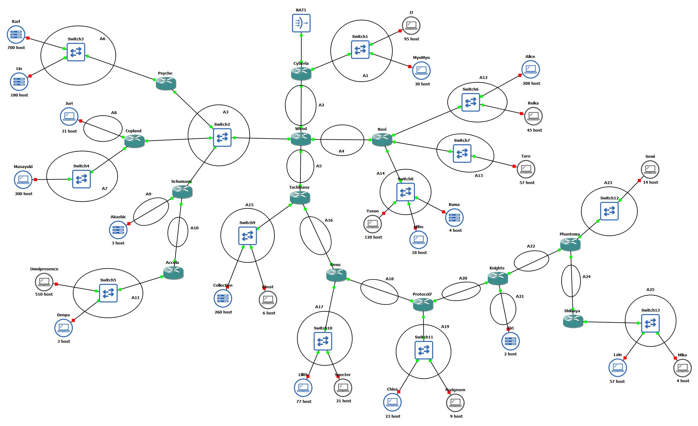
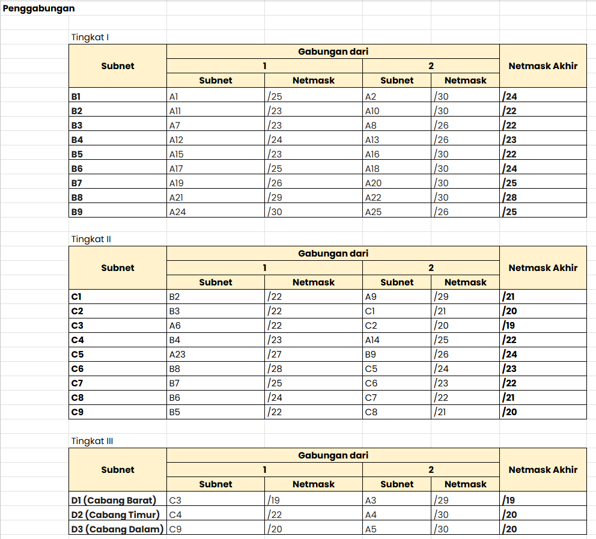
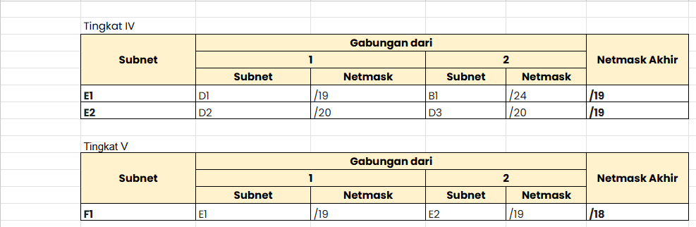
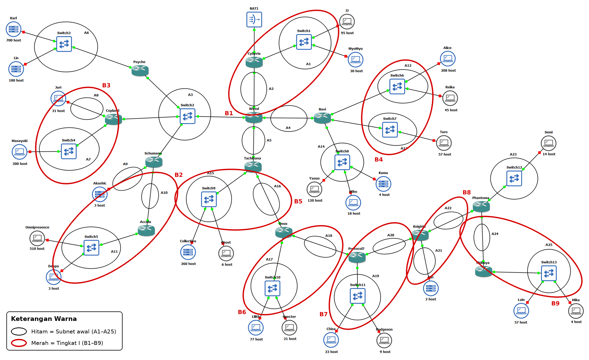
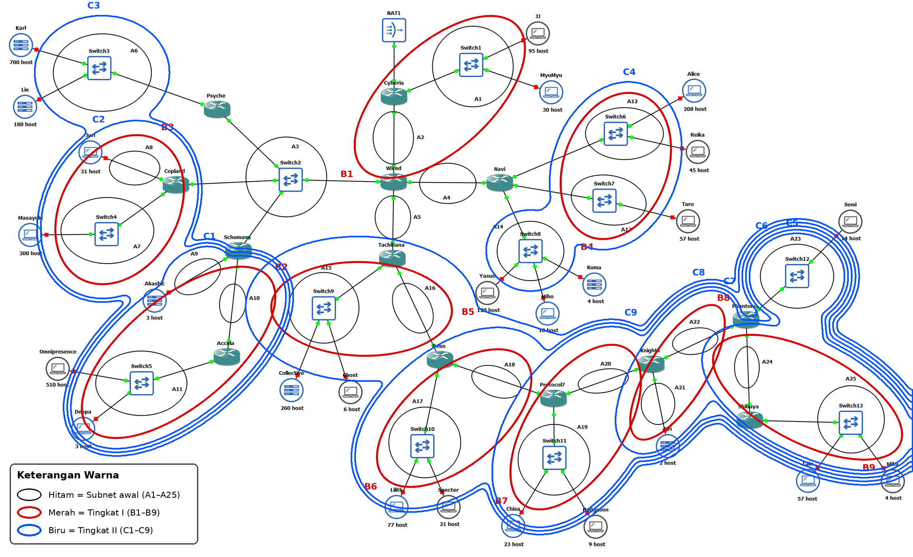
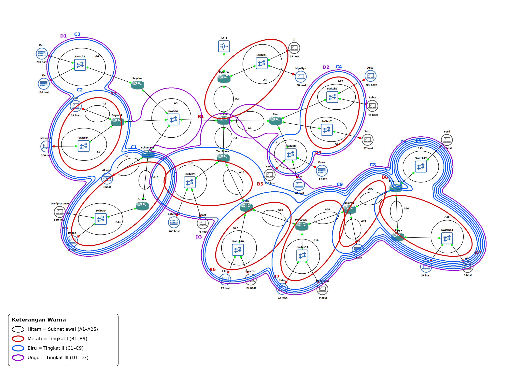
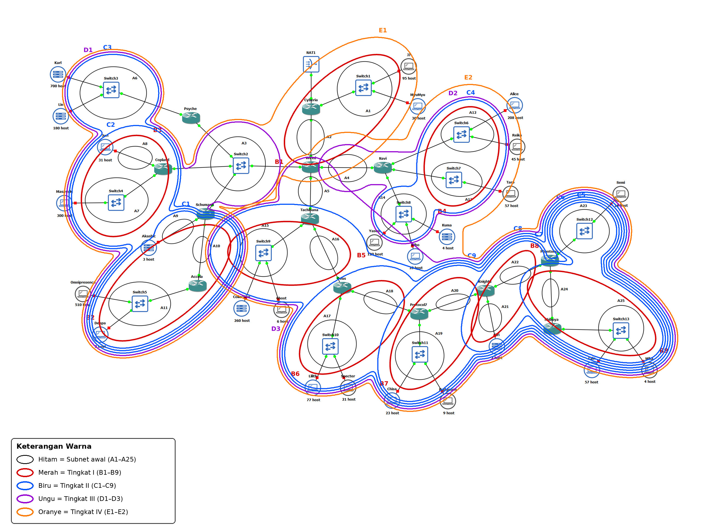
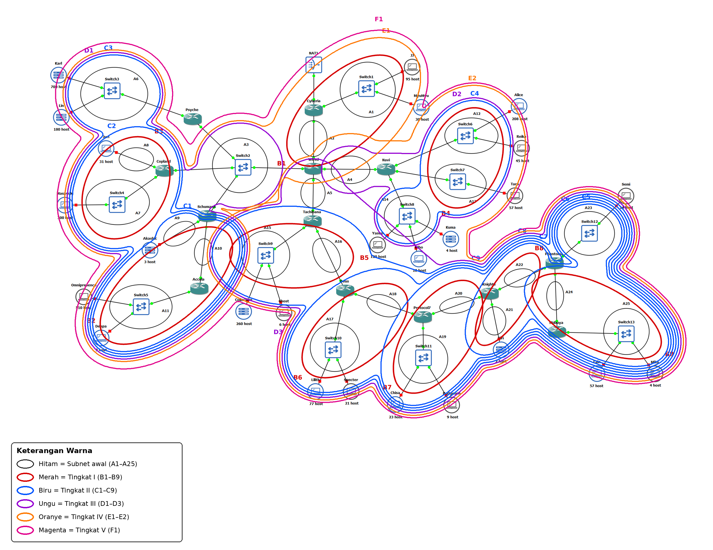
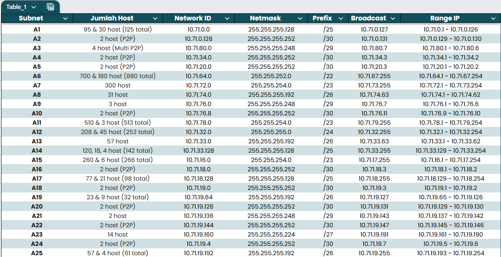

# Jarkom-Modul-4-2026-K-15

| Nama | NRP |
| ---  | --- |
| I Made Tobby Anantha Adiwijaya | 5027251064 |
| Rheza Pramudita Adi Putra | 5027251090 |

## Link Spreadsheet
[LINK SPREADSHEET]  
https://docs.google.com/spreadsheets/d/11alOrE_nM6N1S3ChYQFPtsKm0776pas7/edit?usp=sharing

## CPT - VLSM

placeholder.

## GNS3 - CIDR

GNS3 di sini yang digunakan...

### Topologi

### Perhitungan Penggabungan IP (Supernetting)

Visualisasi sebagai berikut.

### Perhitungan Pembagian IP (Subnetting)

### Konfigurasi & Routing

### Test Koneksi (Ping)
